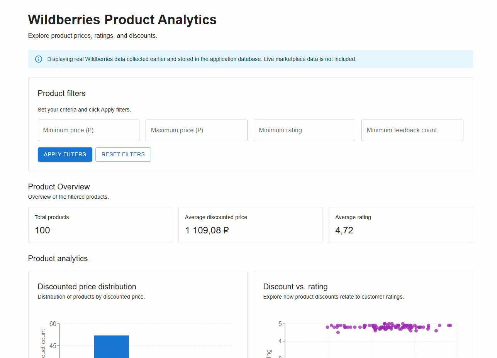
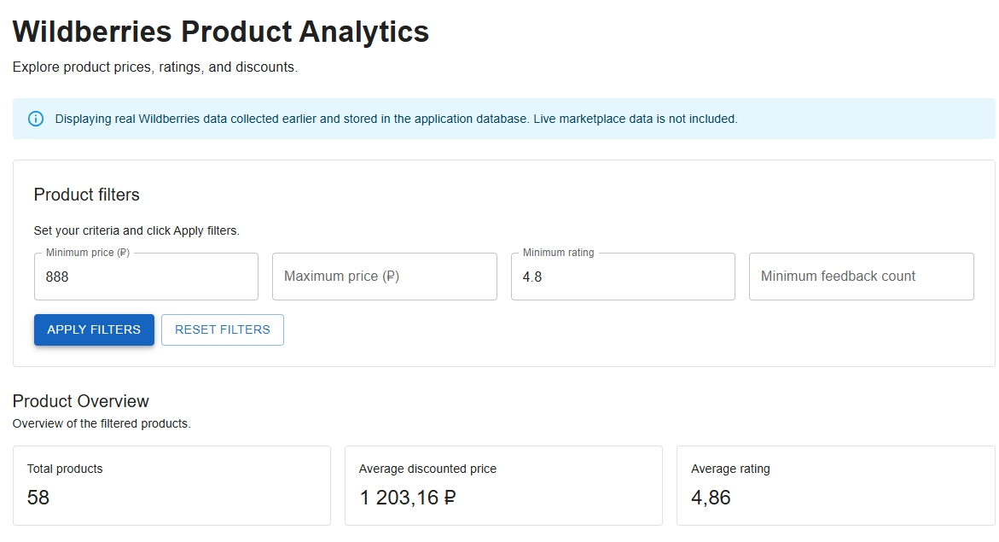
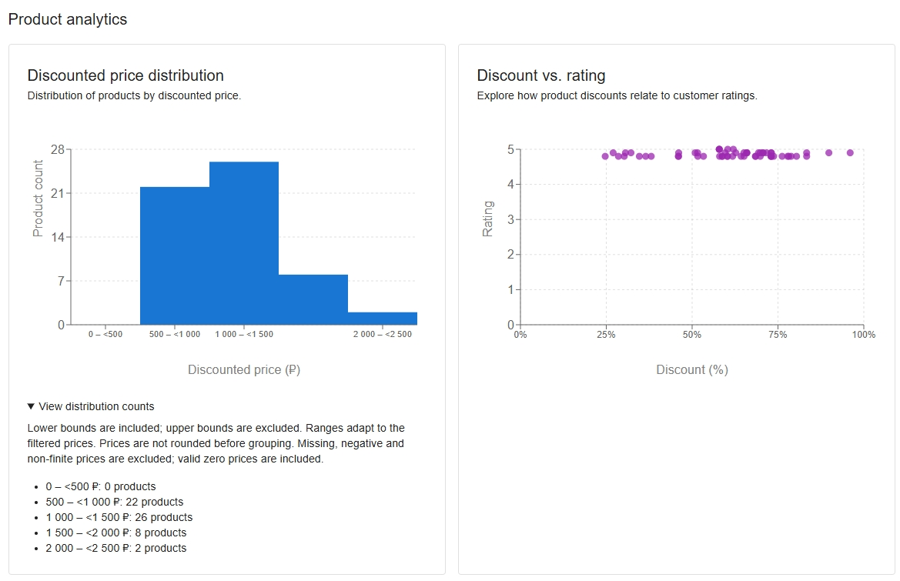
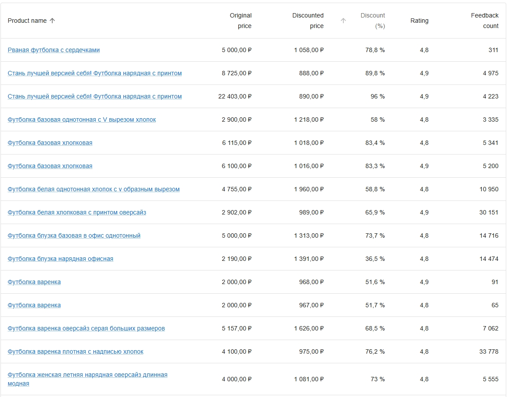

<div align="center">

# Wildberries Product Analytics

A full-stack web application for exploring and analyzing Wildberries product data, built with FastAPI, React, and SQLite.

Features interactive filtering, sortable product tables, and visual analytics using 100 real Wildberries products previously collected and stored in SQLite.


[](https://github.com/nikolaitolmachev/wb-product-analytics/actions/workflows/backend.yml)
[](https://github.com/nikolaitolmachev/wb-product-analytics/actions/workflows/frontend.yml)
[](LICENSE)

</div>

---

## Demo

<div align="center">



</div>

---

## Features

- **Product Collection & Storage** — Collect Wildberries product data through an API-based parser and store it in SQLite, subject to endpoint availability.
- **Product Filtering** — Filter products by price range, minimum rating, and feedback count.
- **Analytics Dashboard** — Explore summary metrics, price distributions, and discount-versus-rating relationships through interactive charts.
- **Product Table** — Browse and sort products by name, prices, discounts, ratings, and feedback count.

---

## Tech Stack

| Component | Technologies |
|---|---|
| **Backend** | Python 3.12, FastAPI, Pydantic, SQLAlchemy |
| **Database** | SQLite |
| **Frontend** | React 19, JavaScript, Vite, Material UI, Recharts |
| **HTTP Clients** | Requests, Axios |
| **Testing** | pytest, Vitest, React Testing Library |
| **Code Quality** | Ruff, ESLint |
| **CI** | GitHub Actions |

---

## Architecture

```text
              React (Material UI + Recharts)
                           |
                         Axios
                           |
                           v
                     FastAPI REST API
                           |
                +----------+----------+
                |                     |
                v                     v
        Product Retrieval       WB Product Parser
          & Filtering                  |
                |                     v
                |              Wildberries API
                |                     |
                v                     |
            SQLAlchemy <--------------+
                |
                v
              SQLite
```

---

## Screenshots

<table>
  <tr>
    <th align="center">Dashboard Overview</th>
    <th align="center">Analytics</th>
    <th align="center">Product Table</th>
  </tr>
  <tr>
    <td></td>
    <td></td>
    <td></td>
  </tr>
</table>

---

## Getting Started

Clone the repository and follow the setup instructions for each component:

```bash
git clone https://github.com/nikolaitolmachev/wb-product-analytics.git
cd wb-product-analytics
```

- [Backend Development Guide](backend/README.md) — Installation, database configuration, and API setup.
- [Frontend Development Guide](frontend/README.md) — Installation, development server, and production build.

---

## Future Improvements

- **Wildberries API Integration** — Adapt the product parser to supported data access methods for reliable collection.
- **Historical Price Tracking** — Store periodic price snapshots to analyze trends and changes over time.
- **Data Export** — Export filtered product data to CSV or Excel.

---

## License

This project is licensed under the MIT License. See the [LICENSE](LICENSE) file for details.
